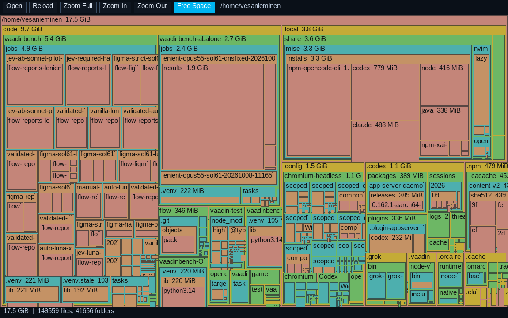

# diskmap-linux

A tiny, fast disk-space visualizer for Linux, heavily inspired by
[SpaceMonger 1.4](https://www.snapfiles.com/screenshots/spacemonger.htm)
and by its own sibling, [DiskMap](https://github.com/vesanieminen/DiskMap)
for macOS: every folder and file is a box whose size is proportional to the
space it takes, nested inside its parent, colored by nesting depth.

Single-file C11 app using SDL2 + FreeType. The stripped binary is **~68 KB**
and it dynamically links only SDL2, FreeType and Fontconfig.

## Build

    make            # needs gcc/clang, SDL2, freetype2, fontconfig headers

On Arch: `sudo pacman -S sdl2 freetype2 fontconfig`

## Use

    ./diskmap                 # scans $HOME
    ./diskmap ~/Downloads     # scans a given path

Scanning runs in a background thread — the window stays responsive and shows
progress; ~190k files scan in about 3 seconds.

### Reading the map

- **Color = nesting depth**, borrowed from the macOS DiskMap: the folders in
  the current view are salmon, what's inside them is yellow, inside that
  green, then cyan, then orange, and so on. Because every level has its own
  color, the contents of a folder are always visually highlighted against
  the folder itself.
- The map deliberately stays **high level**: nesting stops after 5 levels
  (and at ~42×38 px). To dig deeper, **zoom in** — the zoomed folder becomes
  the new salmon root and its contents light up level by level again.
- Each box is labeled `name  size` when it is wide enough; hover any box
  for the full path, size, date and % of the current view.
- When you scan a filesystem root (e.g. `/`), the **pink box** shows the
  free space on that filesystem, just like SpaceMonger.
- Sizes are *allocated* disk usage (`st_blocks`), so the totals match
  `du -sx` exactly.
- The frame (toolbar, buttons, status bar, tooltip) follows your
  [Omarchy](https://omarchy.org/) theme: colors are read from
  `~/.local/state/omarchy/current/theme/colors.toml` at startup and on
  Reload, so `omarchy theme set ...` + Reload restyles the app. When the
  theme has `mode = "dark"`, the box fills are muted slightly toward the
  theme background (same hues, softer fills, black labels). Without
  Omarchy, built-in dark defaults are used.

### Controls

| Action | Mouse | Keys |
| --- | --- | --- |
| Zoom into folder | left-click | `Right` / wheel-up (biggest child) |
| Zoom out | — | `Esc`, `Backspace`, `Left`, wheel-down |
| Zoom to root | `Zoom Full` button | `g` |
| Reload | `Reload` button | `r` |
| Free-space box on/off | `Free Space` button | `f` |
| Scan another path | `Open` button | `o`, type path, `Tab` completes, `Enter` |
| Copy full path | right-click | — |

Hover any box for an info tip: full path, size, date, % of the current view.

### Test hooks

`DISKMAP_ONESHOT=1` exits after the first scan (prints a summary),
`DISKMAP_SHOT=frame.bmp` saves the rendered frame, `DISKMAP_ZOOM=sub/dir`
zooms after the scan — handy for scripted smoke tests.
